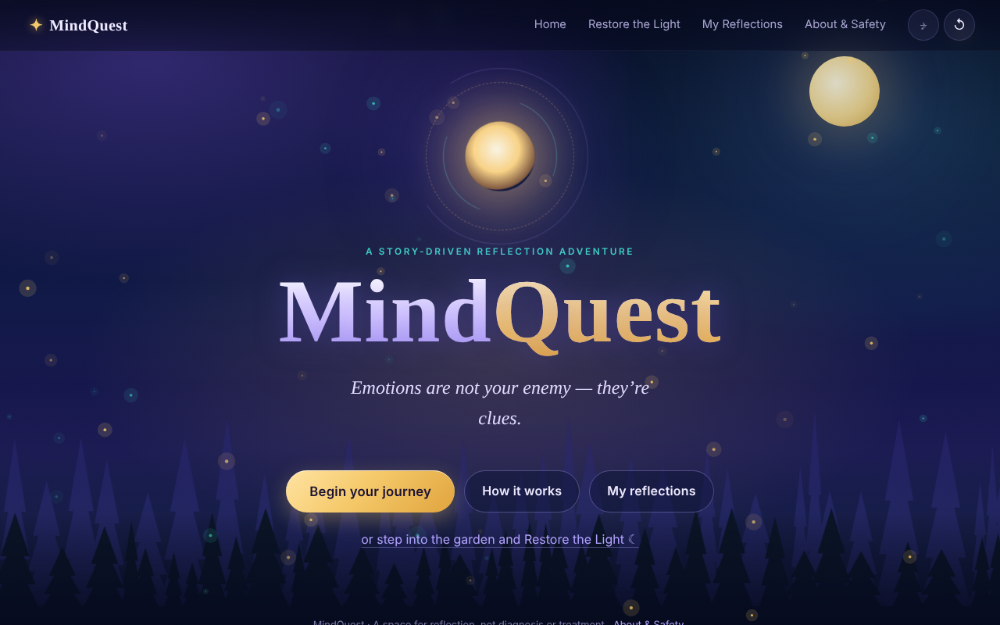
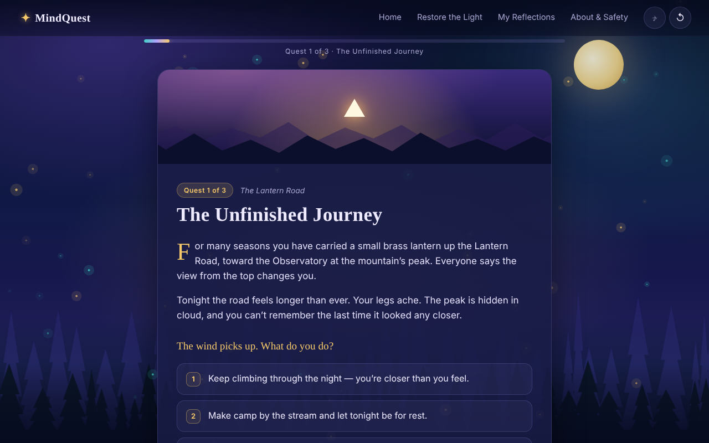
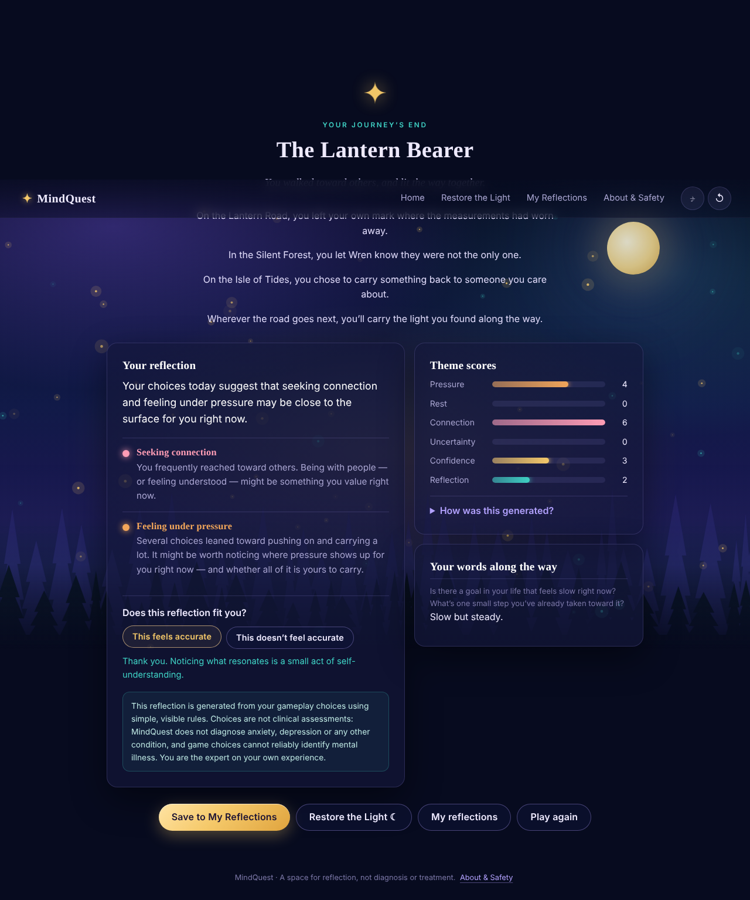
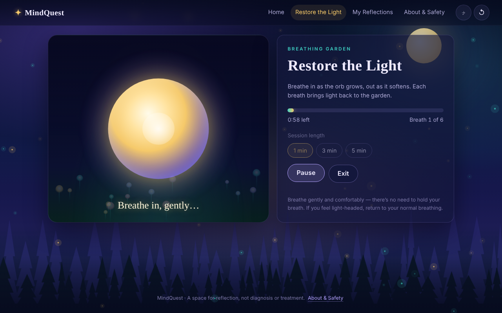
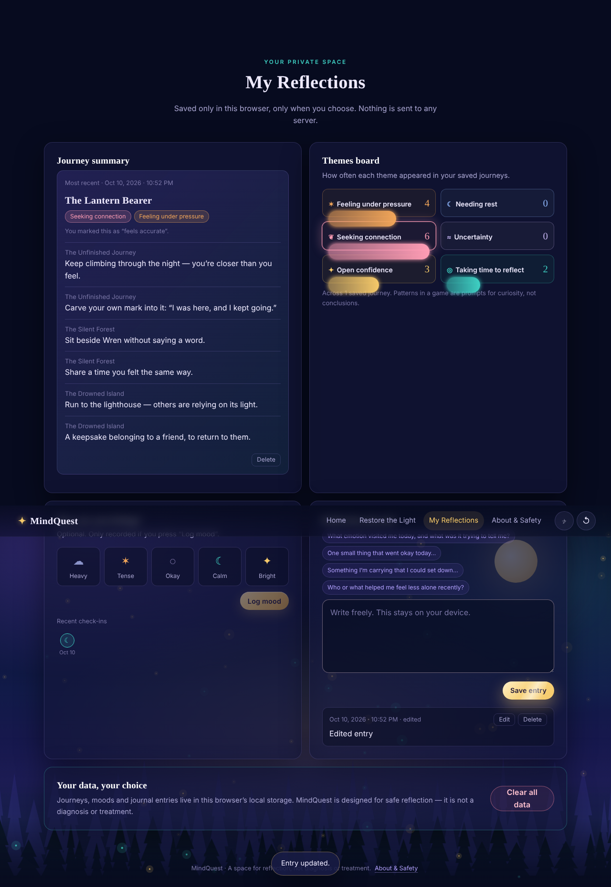
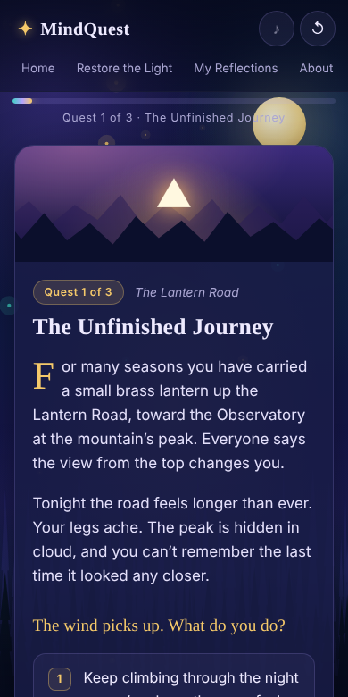

# MindQuest

> **Emotions are not your enemy — they're clues.**

MindQuest is a story-driven reflection game that runs entirely in the browser. Instead of a questionnaire, you walk through three short fantasy quests, make choices with no right or wrong answer, and receive a gentle, personalised reflection built from what you actually chose. A guided breathing garden and a private journal round out the experience.

It is built with plain HTML, CSS and JavaScript: **no framework, no build step, no backend, no accounts, no network calls.** Open `index.html` and it works, even offline.



---

## Contents

- [Features](#features)
- [Screenshots](#screenshots)
- [Run it locally](#run-it-locally)
- [Publish with GitHub Pages](#publish-with-github-pages)
- [How the game works](#how-the-game-works)
- [The reflection engine](#the-reflection-engine)
- [Restore the Light (breathing)](#restore-the-light-breathing)
- [My Reflections (dashboard)](#my-reflections-dashboard)
- [Privacy and safety](#privacy-and-safety)
- [Accessibility](#accessibility)
- [Project structure](#project-structure)
- [Customising the content](#customising-the-content)
- [Testing](#testing)
- [Tech notes](#tech-notes)

---

## Features

| Area | What it does |
| --- | --- |
| **Opening screen** | Cinematic enchanted-forest scene built from CSS gradients, an SVG treeline, a glowing portal and animated firefly particles. Buttons: *Begin your journey*, *How it works*, *My reflections*. |
| **Three branching quests** | *The Unfinished Journey*, *The Silent Forest* and *The Drowned Island*. Each has two decision scenes with 3–4 choices, a different narrative response for every choice, an optional reflection question, and a transition into the next quest. |
| **Personalised ending** | One of six endings chosen from your actual choices, with an epilogue that quotes what you did along the way. |
| **Reflection engine** | Transparent, rule-based mapping from choices to six broad themes. You can inspect exactly how your result was produced. |
| **Restore the Light** | A guided breathing mini-game: an orb swells and softens while an enchanted garden gradually brightens. Start, pause/resume, exit, progress bar, completion message and *Breathe again*. Default session is 5 minutes. |
| **My Reflections** | A dashboard with your saved journey summary, a themes board, an optional mood check-in and a private journal with save, edit and delete. A *Clear all data* button erases everything. |
| **Polish** | Smooth screen transitions, animated buttons, a journey progress bar, toasts, confirm dialogs, empty states, a restart button and a sound toggle (synthesised chimes, no audio files). |
| **About & Safety** | A clear statement that MindQuest is for reflection, not diagnosis or treatment, with a support line. |

## Screenshots

| Quest | Personalised ending |
| --- | --- |
|  |  |

| Restore the Light | My Reflections |
| --- | --- |
|  |  |

| Mobile |
| --- |
|  |

---

## Run it locally

You only need a modern browser.

**Option 1 — open the file.** Download or clone the repo and double-click `index.html`.

**Option 2 — a tiny local server** (handy if you prefer `http://` over `file://`):

```bash
git clone https://github.com/raopriyanshii/Mindquest.git
cd Mindquest
python3 -m http.server 8000
# then open http://localhost:8000
```

Any static server works (`npx serve`, VS Code Live Server, etc.). Nothing needs installing.

## Publish with GitHub Pages

1. Push the repo to GitHub (it must be **public** for free Pages).
2. Go to **Settings → Pages**.
3. Under **Build and deployment**, choose **Deploy from a branch**, select branch `main` and folder `/ (root)`, then save.
4. After about a minute the site is live at `https://<your-username>.github.io/<repo-name>/`.

Because all paths are relative and there are no external assets, it works on Pages (and Netlify, Vercel, Cloudflare Pages) with no configuration.

---

## How the game works

1. **Begin your journey** starts a fresh in-memory journey.
2. Each quest follows the same rhythm: *scene → your choice → story response → second scene → your choice → story response → optional reflection question → quest complete*.
3. A progress bar and a "Quest 2 of 3" label show where you are. There are no timers and no scores shown mid-game.
4. After the third quest the reflection engine produces your ending.
5. You can **save** the journey to My Reflections, play again, visit the breathing garden, or open the dashboard.

**Keyboard:** press `1`–`4` to choose an option, `Esc` closes dialogs, and `Ctrl/Cmd + Enter` saves a journal entry.

**Choices have real consequences.** No option is "correct". Each choice changes the story text you read next, adds weight to one or two themes, and, in the second scene of each quest, adds a line to your personalised epilogue.

## The reflection engine

The engine lives in the `Reflection` object in `script.js` and is deliberately simple and visible.

**Six themes:**

| Theme | Meaning (tentatively worded in the app) |
| --- | --- |
| Feeling under pressure | Pushing on, carrying a lot |
| Needing rest | Pausing, slowing down |
| Seeking connection | Reaching toward other people |
| Uncertainty | Sitting with the unknown |
| Open confidence | Trusting your own direction |
| Taking time to reflect | Stepping back for the bigger picture |

**The rules:**

1. Every option in `QUESTS` carries theme weights, for example `{ pressure: 2, confidence: 1 }`.
2. Your choices are summed into a score per theme.
3. The two highest-scoring themes (ties keep the order above) shape the opening sentence, the insight cards and the ending title.
4. Wording stays cautious and non-judgmental: *"Your choices today suggest that…"*, *"may be close to the surface for you right now"*.
5. A **"How was this generated?"** panel lists every choice you made and the exact points it added.
6. You can respond with **This feels accurate** or **This doesn't feel accurate**. The answer is shown back to you and stored with the journey if you save it.

**What it is not.** The reflection is generated from gameplay choices. It is not a clinical assessment, it does not diagnose anxiety, depression or any other condition, and game choices cannot reliably identify mental illness. This is stated on the ending screen and on the About & Safety page.

## Restore the Light (breathing)

- A comfortable, unforced rhythm: **4 seconds in, 6 seconds out**, with **no breath-holding**.
- The orb grows on the inhale cue and softens on the exhale cue; the garden glow brightens and flowers bloom as the session progresses.
- Choose **1, 3 or 5 minutes** (5 is the default, roughly 30 breaths).
- Controls: **Start**, **Pause / Resume**, **Exit**. A visible progress bar, time remaining and breath counter are always shown. On completion you see a message and can **Breathe again**.
- Timing uses `requestAnimationFrame` with a capped time step, so pausing is exact and a background tab can't fast-forward the session. Leaving the screen pauses the session instead of losing it.
- With sound on, soft tones mark inhale and exhale. All sound is synthesised with the Web Audio API.

## My Reflections (dashboard)

- **Journey summary:** your most recent saved journey, its themes and choices, plus earlier journeys. Unsaved finished journeys prompt you to save.
- **Themes board:** cumulative theme totals across saved journeys, with your most frequent theme highlighted.
- **Mood check-in:** optional. Pick a mood and press *Log mood*; nothing is recorded until you do.
- **Private journal:** write, **save**, **edit** and **delete** entries. Writing-prompt chips can start an entry for you.
- **Clear all data:** erases saved journeys, moods and journal entries after a confirmation.

Every panel has a clear empty state for first-time visitors.

## Privacy and safety

- **Everything stays on your device.** Nothing is sent to a server; there are no analytics, cookies, accounts or external requests.
- The browser's `localStorage` (key `mindquest.v1`) is used **only** for things you explicitly save: journeys, mood check-ins and journal entries. Answers you type during a quest are held in memory and are only stored if you save the journey.
- Corrupted or missing storage is handled safely: the app starts empty rather than crashing, and tells you if saving isn't possible (for example in a private window).
- MindQuest is designed for **safe reflection, not diagnosis or treatment**. It is not a substitute for professional care.
- If you are in distress, please reach out to someone you trust or a professional. In India you can call **Tele-MANAS at 14416** (free, 24×7). In an emergency, contact your local emergency number.

## Accessibility

- Full keyboard operation with visible focus rings and a *Skip to content* link.
- Semantic landmarks, labelled controls, `aria-live` regions for toasts, cues and feedback, and `role="progressbar"` on progress indicators.
- Focus moves to the new screen's heading on navigation, and the confirm dialog traps focus and closes with `Esc`.
- **Respects `prefers-reduced-motion`:** animations are effectively disabled, particles stop drifting, and the breathing orb uses a gentler glow-led change instead of large scaling.
- Responsive from small phones to wide desktops; the top navigation scrolls horizontally on narrow screens.

## Project structure

```
Mindquest/
├── index.html   # Markup for every screen (home, how it works, quest, ending,
│                #   breathing, dashboard, about) plus the confirm dialog and toast
├── style.css    # Design tokens, layout, components, responsive rules, reduced motion
├── script.js    # All behaviour, organised in numbered sections (below)
├── docs/        # Screenshots used in this README
└── README.md
```

`script.js` is organised top to bottom so it reads like a table of contents:

1. **Content:** `THEMES`, `MOODS`, `JOURNAL_PROMPTS`, `QUESTS`
2. **Storage:** `Store` (load, save, clear with safe fallbacks)
3. **App state:** a single `state` object and `newJourney()`
4. **Helpers:** DOM shortcuts, HTML escaping, toast, accessible confirm dialog
5. **Sound:** tiny Web Audio chimes, off by default
6. **Screen router:** `showScreen()` and focus management
7. **Background:** SVG treeline and canvas fireflies
8. **Quest engine:** `renderQuest()`, `chooseOption()`, `continueQuest()`, …
9. **Reflection engine:** `Reflection.score / rank / summarize`
10. **Ending screen:** rendering, feedback, saving a journey
11. **Restore the Light:** the `Breath` controller
12. **Dashboard:** summary, themes, moods, journal
13. **Event wiring and `init()`:** one delegated click handler driven by `data-action` / `data-nav` attributes

User-written text is always passed through `esc()` before being inserted into the page.

## Customising the content

Everything story-related is data in `script.js`, so you can change it without touching the logic.

**Add or edit a choice** inside a quest scene's `options` array:

```js
{
  id: 'rest',
  label: 'Make camp by the stream and let tonight be for rest.',
  themes: { rest: 2 },                 // weights toward themes
  response: ['Paragraph one…', 'Paragraph two…'],
  epilogue: 'Optional line used in the ending (second scenes).',
}
```

- **Add a quest:** append an object to `QUESTS` with `id`, `title`, `place`, `emblem`, `palette` (`dawn`, `forest` or `tide`), two `scenes`, a `reflect` question and an `outro`. Progress and navigation adapt automatically.
- **Add a theme:** add an entry to `THEMES` (label, phrase, colour, insight text, ending title). It appears on the score bars and dashboard automatically.
- **Re-theme the look:** colours, fonts and spacing are CSS variables at the top of `style.css`.
- **Change breathing pace:** edit `Breath.INHALE` and `Breath.EXHALE` (seconds).

## Testing

The complete journey was exercised end to end in headless Chromium (Playwright), with zero console errors:

open the game → How it works → begin the journey → play all three quests (answering one reflection and skipping the others) → receive the personalised reflection → mark it accurate → save it → run the breathing session (pause, resume, completion, *Breathe again*, exit) → log a mood → write, edit and reload to confirm journal persistence → delete an entry → *Clear all data* → restart the game. A phone-sized viewport (390 px) was also checked for horizontal overflow.

**Manual checklist** if you want to re-verify:

- [ ] Home buttons all navigate (Begin, How it works, My reflections, garden link)
- [ ] Number keys choose options; every choice shows a different response
- [ ] Reflection can be answered and skipped; progress bar advances
- [ ] Ending shows theme scores, the *How was this generated?* panel and both feedback buttons
- [ ] *Save to My Reflections* appears on the dashboard and survives a reload
- [ ] Breathing: start, pause, resume, exit, and completion message
- [ ] Journal: save, edit, delete; mood: select and log
- [ ] *Clear all data* and the restart button each ask for confirmation
- [ ] Enable "reduce motion" in your OS and confirm the UI stays calm and usable

## Tech notes

- Vanilla HTML, CSS and ES2020+ JavaScript. No dependencies, bundler or package manager.
- No external fonts or images: system font stacks, CSS gradients, inline SVG and `<canvas>` only, so it works fully offline.
- Visuals use `backdrop-filter`, `color-mix()` and `:has()`, which are supported in current evergreen browsers.
- Works from `file://`; no server features are required.

---

*MindQuest is a space for reflection, not a diagnosis, test or treatment.*
